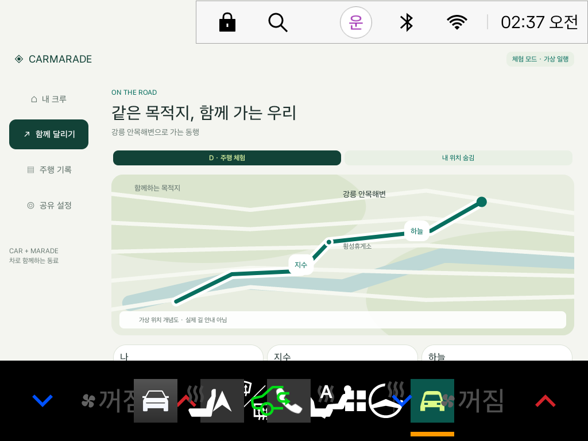
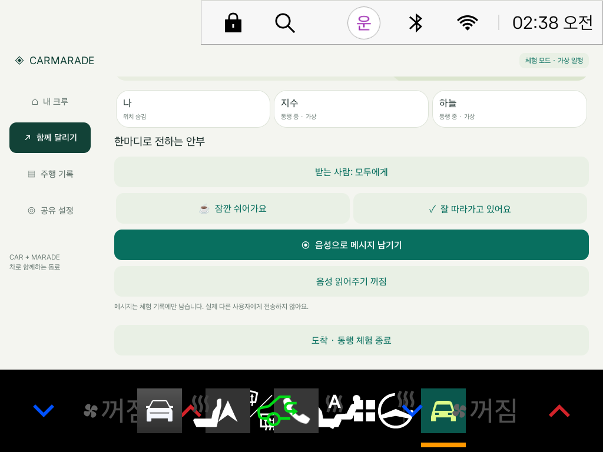
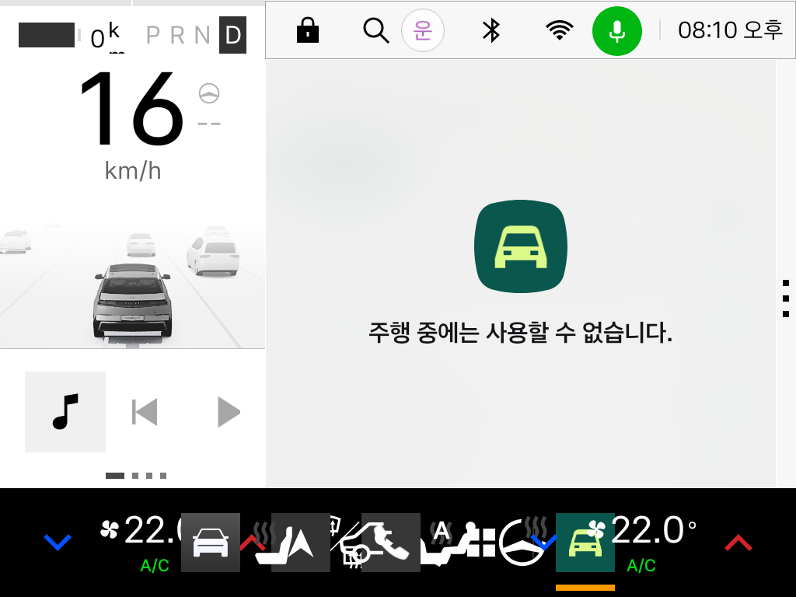
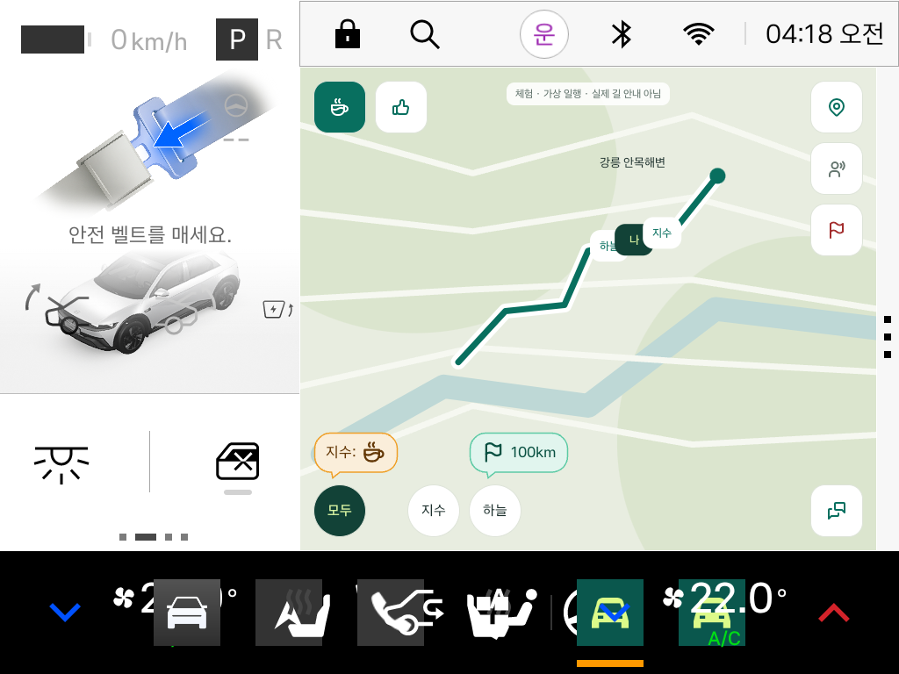
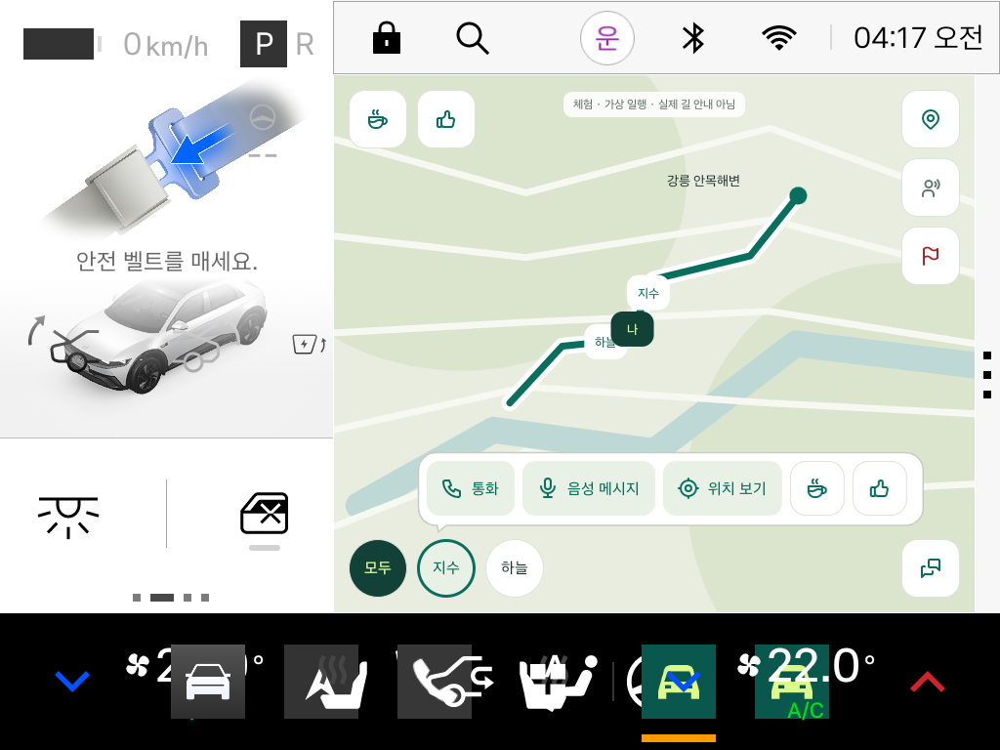
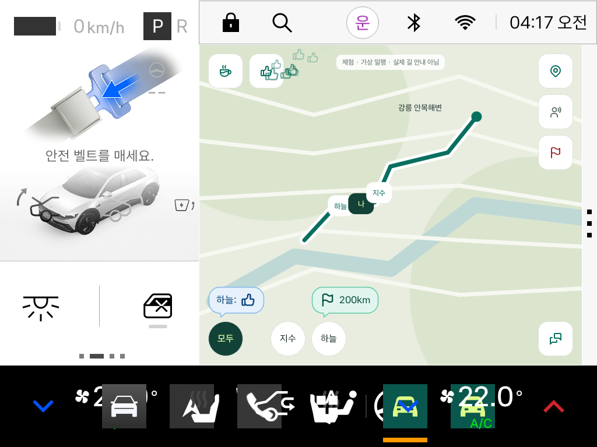
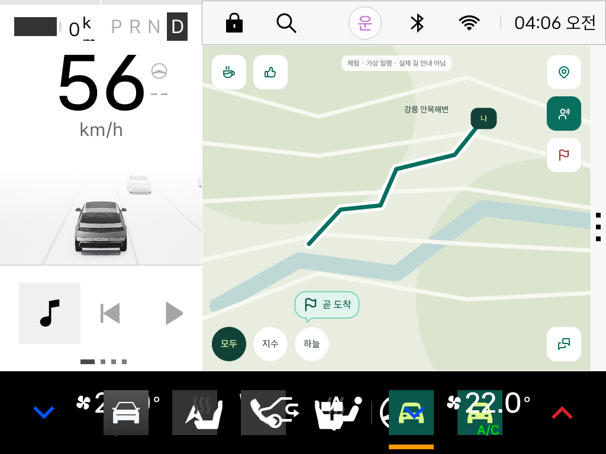
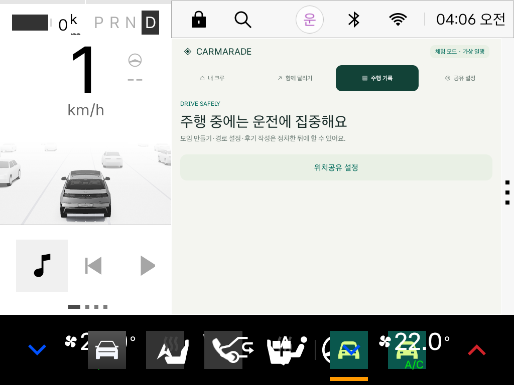

# 주행 체험 화면 개편: 이전 vs 변경

2026-11-08. Pleos Connect v2.1.0 에뮬레이터(1024×768)에서 캡처했습니다.

- 이전 화면은 팀원이 만든 첫 버전(`dbc2cd2`)입니다.
- 변경 화면은 이번 PR(#1)의 최신 버전입니다.
- 에뮬레이터가 중간에 "왼쪽 주행 정보 + 오른쪽 앱" 분할 화면으로 바뀌어서, 변경 화면은 오른쪽 영역에 보입니다.

## 한눈에 보기

| | 이전 | 변경 |
|---|---|---|
| 화면 구성 | 일반 앱 화면(왼쪽 메뉴, 위아래 스크롤). 지도는 카드 하나 | 개념도 지도 **전체 화면**. 스크롤 없음 |
| 버튼 | 글자 버튼 여러 줄 | **아이콘만**(선 아이콘). 프로필 메뉴만 글자 |
| 빠른 메시지 | "받는 사람" 고르고 → 버튼 | 왼쪽 위 커피·따봉 = **모두에게 한 번에**. 한 사람에게는 프로필 메뉴에서 |
| 받은 메시지 | 없음(가상 일행은 메시지를 보내지 않음) | 가상 일행이 메시지를 보내고, **프로필 위 말풍선**으로 뜸. 음성으로 읽어 줌 |
| 남은 거리 | 없음 | 일행마다 **100km 단위 → 50·30·10·5·3·1km → 500m → 곧 도착** 말풍선 |
| 음성 읽어주기 | Android 기본 TTS(에뮬레이터엔 한국어 엔진이 없어 안 켜짐) | **Pleos TTS**(ON_DEVICE), 안 되면 Android TTS |
| 주행 중 | Pleos가 앱 전체를 "주행 중에는 사용할 수 없습니다"로 가림 | **주행 화면 계속 표시.** 대신 설정·입력 화면은 정차 후에만 열림 |

## 이전

| 주행 화면 위쪽 | 주행 화면 아래쪽(스크롤) | 차가 움직일 때 |
|---|---|---|
|  |  |  |

## 변경

| 말풍선 | 프로필 메뉴 | 따봉 누름 |
|---|---|---|
|  |  |  |
| 내 쉬어가요 켜짐(왼쪽 위 커피 초록). "모두" 위에 "지수: ☕"(지수가 모두에게 보냄, 정차 전까지 유지). 하늘 위에 "100km" | 지수를 누르면 통화(준비 중)·음성 메시지·위치 보기·지수에게 커피·따봉이 비눗방울처럼 뜸 | 따봉 버튼이 잠깐 켜지고 작은 따봉들이 거품처럼 퍼지며 사라짐 |

| 주행 중(D단 56km/h) | 주행 중 다른 화면 |
|---|---|
|  |  |
| 주행 화면이 가려지지 않음. 음성 읽어주기 켜짐(오른쪽 두 번째 버튼 초록). 하늘 "곧 도착" | 모임 만들기·경로 설정·후기는 "주행 중에는 운전에 집중해요"로 바뀌고 위치공유 설정만 열림. P로 바꾸면 원래대로 |

## 화면 규칙 정리

**왼쪽 위 (모두에게)**
- 커피(쉬어가요)
  - 누르면 켜짐(초록), 다시 누르면 꺼짐(쉬어가기 취소).
  - 내 차가 정차하면 저절로 꺼짐.
- 따봉(잘 따라가고 있어요)
  - 누른 순간만 잠깐 켜지고, 작은 따봉이 거품처럼 퍼짐.
- 둘 다 내 화면에는 말풍선을 띄우지 않음.

**오른쪽**
- 위에서부터 위치공유 설정, 음성 읽어주기 켜기/끄기, 주행 종료.
- 오른쪽 아래는 메시지 기록.

**왼쪽 아래 프로필(모두, 일행)**
- 누르면 메뉴가 뜸.
- 위치 보기: 지도에서 그 차에 점선 원을 그리고 남은 거리를 보여 줌. "모두"는 일행 전체.

**말풍선**
- 위치
  - 모두에게 온 메시지: "모두" 위에 "이름: 아이콘".
  - 나에게만 온 메시지: 보낸 사람 위.
  - 내가 한 사람에게 보낸 메시지: 그 사람 위에 "나:".
- 유지 시간
  - 쉬어가요는 그 차가 정차할 때까지. 다른 메시지가 와도 닫히지 않고 위로 쌓임.
  - 나머지는 10초.
- 자리
  - 말풍선이 길면 오른쪽 프로필이 밀려남.
  - 자리가 모자라면 오래된 말풍선부터 닫힘(정차 전 쉬어가요는 마지막까지).

**거리 알림**
- 일행 각자 프로필 위에 띄움.
- 100km 이상은 100km 단위(내림), 그 아래는 50·30·10·5·3·1km, 500m, 곧 도착.
- 내 거리는 내 내비가 보여 주므로 띄우지 않음.

## 체험용으로 가정한 부분 (실차 연결 시 바꿀 것)

- **거리:** 실제 위치가 아니라 출발 후 시간(약 4분에 도착)으로 줄어듦. → 서버로 받은 일행 위치와 NaviHelper 남은 거리로 바꿔야 함.
- **정차:** 쉬어가요를 보낸 뒤 20초 지나 20초간 정차한 것으로 처리함. → Vehicle SDK의 기어(P)·속도로 판단해야 함.
- **가상 일행 메시지:** 15·40·65·140초에 정해진 메시지를 보냄. 실제 전송은 없음. → 서버 중계가 필요함.
- **주행 중 표시:** `distractionOptimized` 선언은 에뮬레이터에서만 확인함. App Market 심사에서 허용되는지는 확인 필요.
- **웹 미리보기(`preview/`):** 아직 이전 주행 화면임.
