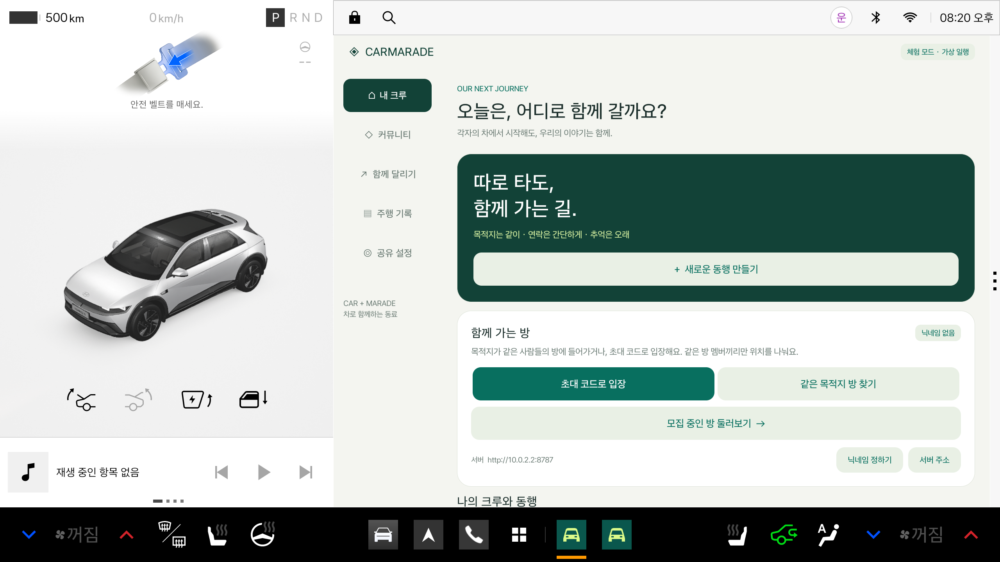
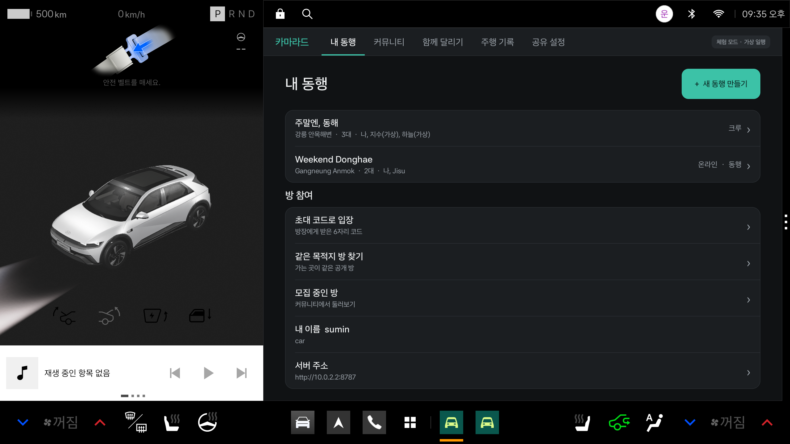
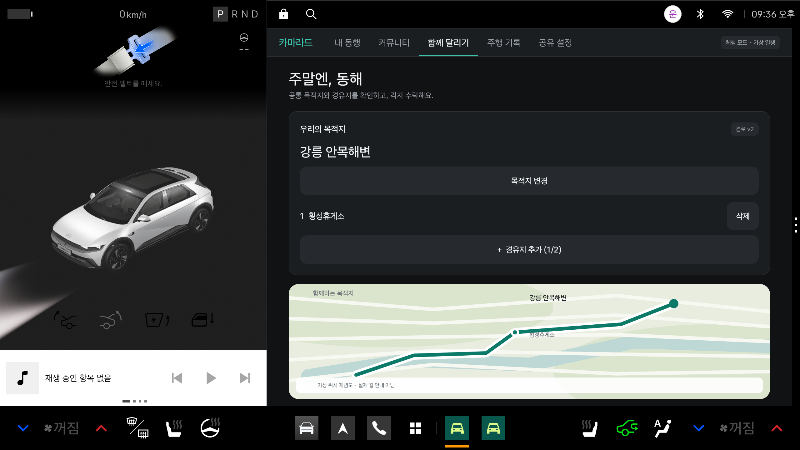

# 네이티브 UI 교체: Pleos 바탕 + 카마라드 포인트 (2026-11-14)

## 왜
홈·방·커뮤니티 화면이 웹 랜딩 페이지처럼 보였습니다. 짙은 초록 히어로 카드와 슬로건, 영문 소제목(OUR NEXT JOURNEY 등), 카드 안의 카드, 왼쪽 세로 메뉴, 긴 안내문이 원인이었습니다. Pleos 기본 화면(밝은 회색·흰 면·검정 글자·얇은 선)과도 따로 놀았고, 밤 모드가 없어 시스템과 어긋났습니다. Pleos 가이드는 "최소한의 글", 1~2초 안에 파악, 낮·밤에 맞는 밝기를 요구합니다.

## 바뀐 것
- **색(`Palette`):** 무채색 바탕 + 초록 하나. 초록은 눌러야 하는 것·선택된 것·일행을 나타내는 곳에만 씁니다. 라임과 짙은 초록 면은 없앴습니다.
  - 라이트와 다크 두 벌. 시스템 야간 모드(`uiMode`)를 따라가며, Pleos가 밤 모드가 되면 앱도 같이 어두워집니다. 대화상자·체크박스 같은 기본 위젯도 `values-night` 테마로 어두워집니다.
  - 지도 위에 그리는 글자·점은 지도가 항상 밝아서 `mapInk/mapMuted/mapAccent` 고정색을 씁니다.
- **내비게이션:** 왼쪽 세로 메뉴 대신 위쪽 탭(선택 탭은 초록 밑줄, Pleos의 Line 탭과 같은 형태). 이름은 "카마라드" 글자만 둡니다.
- **목록 행:** 카드를 쌓는 대신 구분선으로 나눈 목록 행(`Ui.group`, `Ui.listRow`)을 씁니다. 홈의 동행 목록, 방 참여, 커뮤니티의 코드 입장·모집하기가 이 형태입니다.
- **글 줄이기:** 영문 소제목, 슬로건, 긴 안내문을 없애고 제목 + 한 줄 설명으로 줄였습니다.
- **내용 폭:** 넓은 화면에서 내용이 끝까지 늘어나지 않게 가운데 정렬로 약 940dp까지만 씁니다.
- **버튼:** 주요 버튼만 초록, 나머지는 회색 면 + 검정 글자.
- 주행 화면은 구조를 그대로 두고 색 이름만 새 팔레트로 옮겼습니다.

## 확인한 것 (에뮬레이터 2560×1440)
- 라이트/다크(`adb shell cmd uimode night yes|no`) 모두에서 홈, 커뮤니티, 방, 동행 만들기 화면이 바로 바뀌고 글자가 읽힙니다.
- 빌드 성공, 핵심 로직 테스트는 이 변경과 무관(화면 코드만 수정).

## 아직 안 한 것
- **주행 화면의 다크 모드 확인:** 지도는 밝은 채로 두고 버튼만 어두운 면이 됩니다. 실제로 보지는 못했습니다.
- 후기·기록·공유 설정·동행 만들기의 세부 문구와 간격은 새 부품으로 한 번 더 다듬어야 합니다.
- Pleos Figma 에셋(색 값·아이콘 크기)과 맞춰 보기. 지금 팔레트 값은 에뮬레이터 화면에서 눈으로 맞춘 값입니다.
- 주행 중 애니메이션(말풍선 띠용·거품)은 Pleos 가이드의 "움직이는 요소 최소화"와 충돌할 수 있어 정책 확인이 필요합니다.

| 이전 | 이후(낮) | 이후(밤) |
|---|---|---|
|  |  |  |

| 커뮤니티(낮) | 방(밤) |
|---|---|
|  |  |
