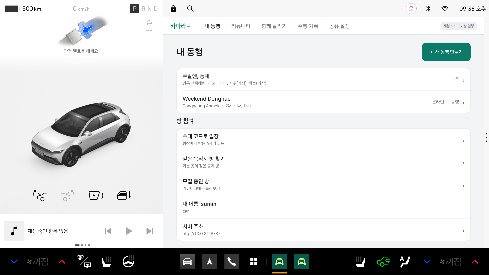
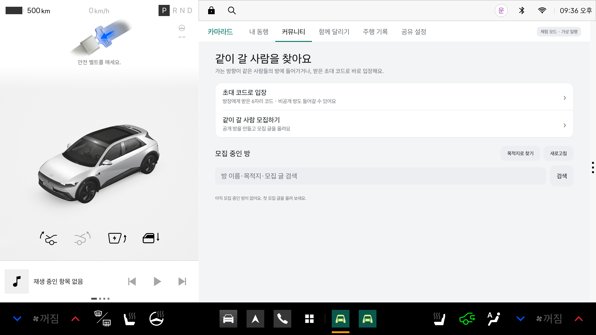
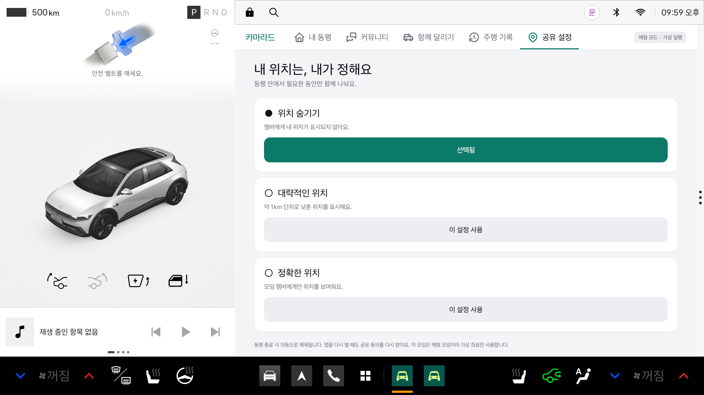
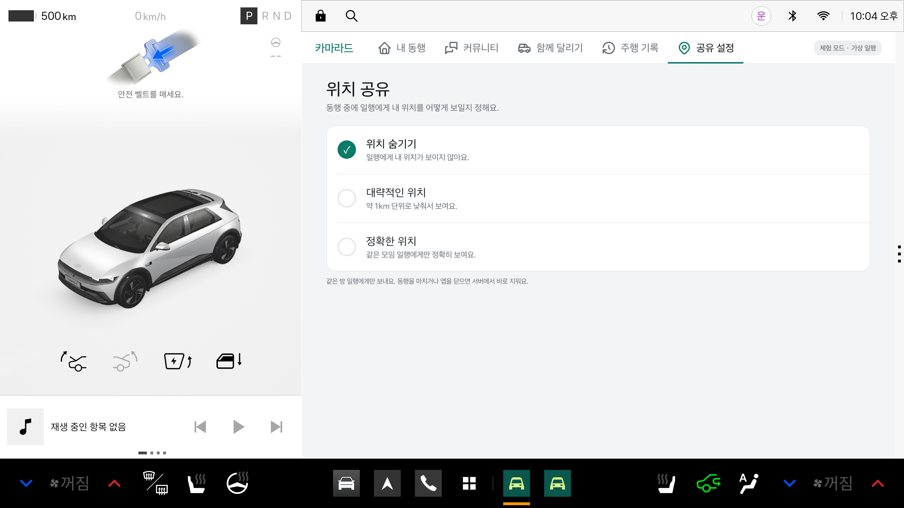
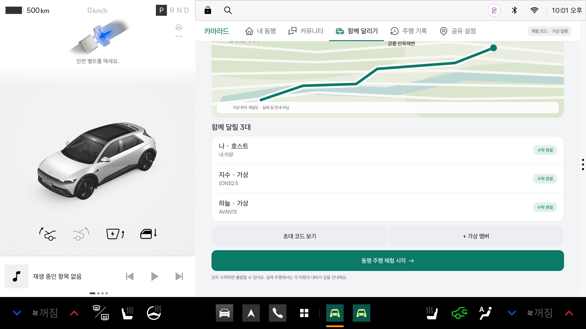
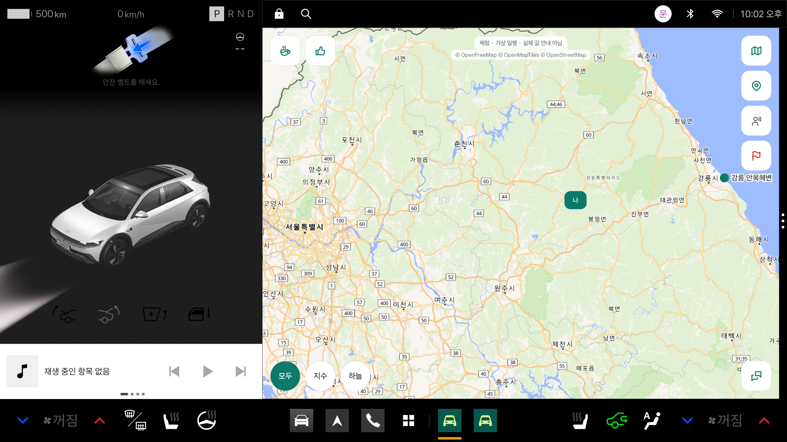
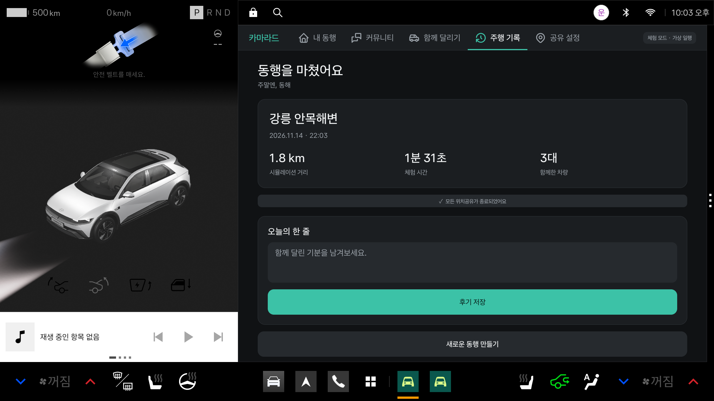
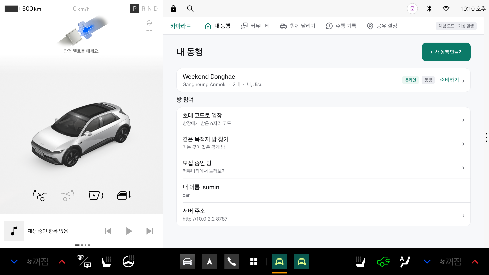
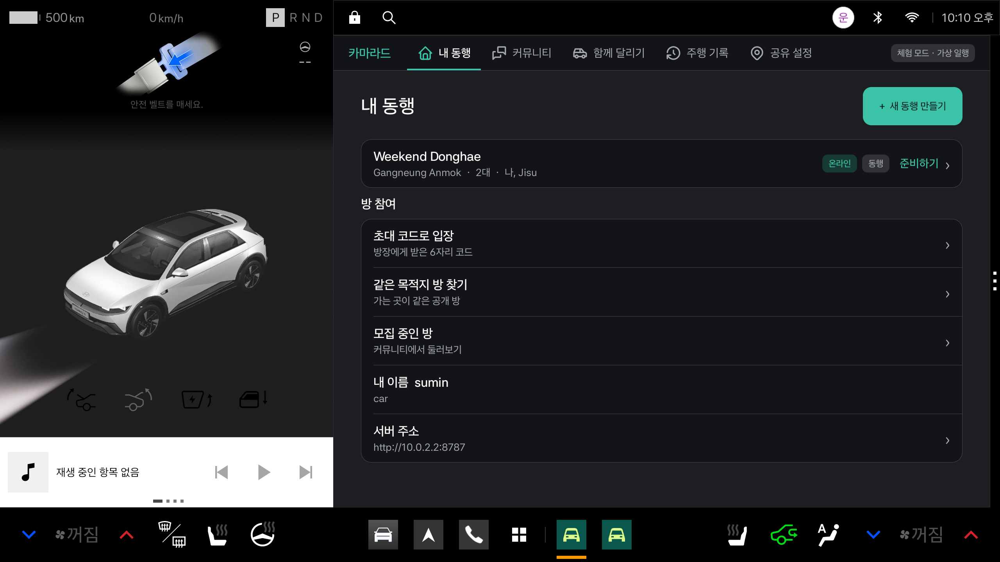
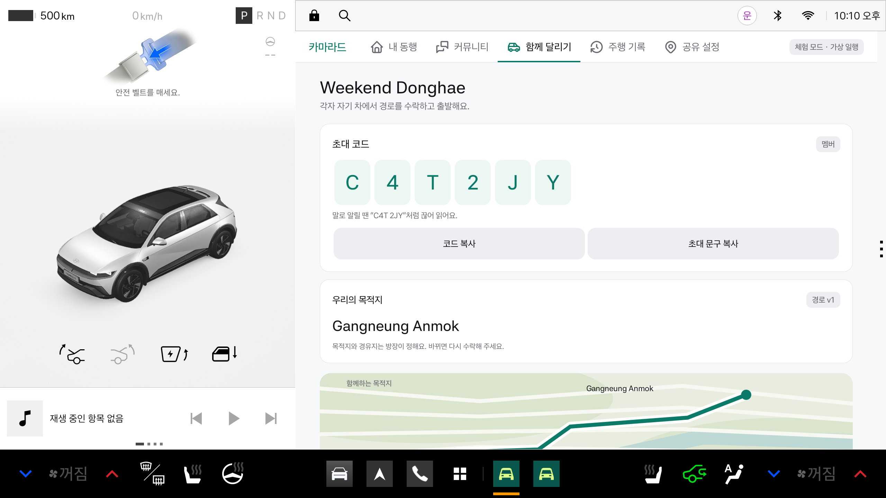

# 네이티브 UI 교체: Pleos 바탕 + 카마라드 포인트 (2026-11-14)

## 왜
홈·방·커뮤니티 화면이 웹 랜딩 페이지처럼 보였습니다. 짙은 초록 히어로 카드와 슬로건, 영문 소제목(OUR NEXT JOURNEY 등), 카드 안의 카드, 왼쪽 세로 메뉴, 긴 안내문이 원인이었습니다. Pleos 기본 화면(밝은 회색·흰 면·검정 글자·얇은 선)과도 따로 놀았고, 밤 모드가 없어 시스템과 어긋났습니다. Pleos 가이드는 "최소한의 글", 1~2초 안에 파악, 낮·밤에 맞는 밝기를 요구합니다.

## 바뀐 것
- **색(`Palette`):** 무채색 바탕 + 초록 하나. 초록은 눌러야 하는 것·선택된 것·일행을 나타내는 곳에만 씁니다. 라임과 짙은 초록 면은 없앴습니다.
  - 라이트와 다크 두 벌. 시스템 야간 모드(`uiMode`)를 따라가며, Pleos가 밤 모드가 되면 앱도 같이 어두워집니다. 대화상자·체크박스 같은 기본 위젯도 `values-night` 테마로 어두워집니다.
  - 지도 위에 그리는 글자·점은 지도가 항상 밝아서 `mapInk/mapMuted/mapAccent` 고정색을 씁니다.
- **내비게이션:** 왼쪽 세로 메뉴 대신 위쪽 탭(선택 탭은 초록 밑줄, Pleos의 Line 탭과 같은 형태). 이름은 "카마라드" 글자만 둡니다.
- **목록 행:** 카드를 쌓는 대신 구분선으로 나눈 목록 행(`Ui.group`, `Ui.listRow`)을 씁니다. 홈의 동행 목록, 방 참여, 커뮤니티의 코드 입장·모집하기가 이 형태입니다.
- **글 줄이기:** 영문 소제목, 슬로건, 긴 안내문을 없애고 제목 + 한 줄 설명으로 줄였습니다.
- **내용 폭:** 넓은 화면에서 내용이 끝까지 늘어나지 않게 가운데 정렬로 약 940dp까지만 씁니다.
- **버튼:** 주요 버튼만 초록, 나머지는 회색 면 + 검정 글자.
- 주행 화면은 구조를 그대로 두고 색 이름만 새 팔레트로 옮겼습니다.

## 확인한 것 (에뮬레이터 2560×1440)
- 라이트/다크(`adb shell cmd uimode night yes|no`) 모두에서 홈, 커뮤니티, 방, 동행 만들기 화면이 바로 바뀌고 글자가 읽힙니다.
- 빌드 성공, 핵심 로직 테스트는 이 변경과 무관(화면 코드만 수정).

## 아직 안 한 것
- **주행 화면의 다크 모드 확인:** 지도는 밝은 채로 두고 버튼만 어두운 면이 됩니다. 실제로 보지는 못했습니다.
- 후기·기록·공유 설정·동행 만들기의 세부 문구와 간격은 새 부품으로 한 번 더 다듬어야 합니다.
- Pleos Figma 에셋(색 값·아이콘 크기)과 맞춰 보기. 지금 팔레트 값은 에뮬레이터 화면에서 눈으로 맞춘 값입니다.
- 주행 중 애니메이션(말풍선 띠용·거품)은 Pleos 가이드의 "움직이는 요소 최소화"와 충돌할 수 있어 정책 확인이 필요합니다.

| 이전 | 이후(낮) | 이후(밤) |
|---|---|---|
|  |  |  |

| 커뮤니티(낮) | 방(밤) |
|---|---|
|  |  |

## 2단계: 이전 디자인보다 뒤처졌던 단서 되돌리기 (2026-11-14)
- 홈 동행 행: 오른쪽에 동작어("준비하기" / "이어가기")와 초록 상태 칩("온라인", "주행 중")을 넣었습니다. 행을 누르면 무엇이 되는지 글로 알려 줍니다.
- 위쪽 탭에 아이콘(홈·대화·차·기록·위치 핀)을 붙였습니다. Pleos 가이드는 아이콘을 글자와 함께 쓰라고 합니다.

## 3단계: 남은 화면 정리 (2026-11-14)
- **공유 설정:** 큰 카드 3개와 "선택됨/이 설정 사용" 버튼 대신, 구분선으로 나눈 선택 행(왼쪽 동그라미, 고르면 초록 체크)으로 바꿨습니다(`Ui.choiceRow`). 설명은 한 줄입니다.
- **주행 기록:** 슬로건 같은 제목을 지우고 "주행 기록 / 마친 동행이 여기에 쌓여요"로 줄였습니다. 기록은 목록 행(+ "보기"), 비어 있으면 한 줄 안내입니다.
- **방 화면:** 멤버 카드 여러 장을 목록 행 하나로 합쳤고, 수락·출발·도착 상태는 칩으로 보입니다. 영문 소제목을 없애고 제목 + 한 줄 설명으로 줄였습니다.
- **동행 만들기·커뮤니티·주행 중 안내·준비 중인 동행 없음:** 영문 소제목과 긴 문구를 정리했습니다.
- **주행 화면 다크 모드:** 지도는 항상 밝아서, 단추·프로필·글자는 낮·밤과 관계없이 밝은 고정색(`Palette.map*`)을 쓰게 했습니다. 그 전에는 일부 단추만 어두운 면으로 바뀌어 섞여 보였습니다. 대화상자(주행 종료)는 밤 모드에서 어두운 테마로 나옵니다.

### 확인 (에뮬레이터 2560×1440, 라이트/다크)
- 공유 설정(선택 행), 주행 기록, 방 화면(멤버 행), 동행 종료 후 기록 화면, 주행 화면과 종료 대화상자를 확인했습니다. 지도 라벨·길은 OpenFreeMap 밝은 스타일 그대로입니다.

### 아직 남은 것
- 주행 화면 지도는 밤에도 밝습니다. 밤용 지도 스타일을 쓸지, 어떤 스타일로 할지 정해야 합니다.
- 방 화면의 "초대 코드 보기", "+ 가상 멤버" 버튼과 동행 만들기 폼의 체크박스·라디오는 기본 위젯입니다. 새 부품으로 바꾸면 더 통일됩니다.
- Figma 에셋 값과 비교(4단계).

| 공유 설정 이전(2단계) | 공유 설정 이후 |
|---|---|
|  |  |

| 방 화면 멤버 행 | 주행 화면(밤) | 동행 종료 기록(밤) |
|---|---|---|
|  |  |  |

## 4단계: Pleos 디자인 가이드 값과 맞추기 (2026-11-14)

Pleos 문서(Foundations > Colors)의 색 표 이미지에서 값을 읽어 팔레트에 반영했습니다. Figma 파일(.fig)은 내려받지 않았습니다. 문서의 표만으로 회색 단계와 시스템 색 이름을 알 수 있었기 때문입니다. 표의 이름과 견본 색이 한 칸씩 어긋나 있는 곳이 있어, 이름이 아니라 견본 색의 실제 픽셀 값을 읽었습니다.

### Pleos 값과 우리 팔레트
| 역할 | Pleos 토큰 | 라이트 | 다크 | 앱 이름 |
|---|---|---|---|---|
| 화면 바탕 | background_secondary | `#F7F8FA` | `#1D1E21` | `Palette.bg` |
| 카드·목록 면 | surface_basic | `#FFFFFF` | `#131417` | `Palette.surface` |
| 눌린·비활성 면 | surface_high | `#EDEEF2` | `#313236` | `Palette.soft` |
| 구분선 | surface_accent | `#E0E1E6` | `#44464E` | `Palette.line` |
| 기본 글자 | basic_900 | `#131417` | `#FFFFFF` | `Palette.ink` |
| 보조 글자 | basic_500 / 400 | `#686A72` | `#A4A8AE` | `Palette.muted` |
| 경고 아이콘 | informative_negative | `#FE3D16` | `#FF4C28` | `Palette.danger` |

- Pleos의 채워진 버튼은 회색(`basic_600`, `#44464E`)이고, 켜짐/활성 표시는 밝은 초록(`informative_active` `#02C265` / `#00E074`)입니다.
- **우리 초록(`#0B7A68` / `#3CC2A7`)은 그대로 둡니다.** Pleos 활성 초록 위에 흰 글자를 올리면 대비가 2.36:1로 4.5:1에 못 미치고, 우리 초록은 5.25:1이기 때문입니다. 글자·버튼에 쓰는 포인트라서 대비를 우선했습니다.

### 대비 (WCAG 계산, Pleos 가이드 기준 4.5:1 이상)
| 조합 | 라이트 | 다크 |
|---|---|---|
| 기본 글자 / 바탕 | 17.3 | 16.7 |
| 보조 글자 / 면 | 5.39 | 7.71 |
| 보조 글자 / 바탕 | 5.08 | 6.98 |
| 보조 글자 / 눌린 면 | 4.65 | 5.36 |
| 초록 글자 / 면 | 5.25 | 8.30 |
| 버튼 글자 / 초록 | 5.25 | 7.82 |
| 칩 초록 글자 / 연초록 면 | 4.79 (바꾼 뒤) | 5.60 |
| 경고 아이콘 / 면 | 3.56 (글자가 아니라 아이콘이라 3:1 기준) | 5.54 |

- 처음 계산에서 모자랐던 두 곳을 고쳤습니다: 칩의 연초록 면을 `#E0F1EC`→`#ECF7F3`으로(4.49→4.79), 경고 **글자**는 아이콘 색 대신 `Palette.dangerText`(`#C62B10`, 5.59)로.

### 글자 크기와 줄 간격
- Pleos 가이드: 일반 글자 높이 3mm 이상, 최소 12sp, 줄 높이 1.5배 이상. 이 화면은 약 229ppi라 앱 배율(1.45배)을 적용한 14sp는 2.3mm 정도입니다. "글자 높이"의 정의가 글에 없어서 정확한 판정은 못 하지만, 기존 12~14sp 글자는 확실히 작았습니다.
- 목록 행 제목 18→20sp, 보조 글 14→16sp, 동작어 16→18sp, 칩 12→14sp, 화면 보조 제목·안내문 12~15→14~16sp로 키웠습니다.
- 줄 간격은 1.35배로 올렸습니다(가이드는 1.5배). 주행 화면 말풍선은 이미 검증한 크기를 그대로 두려고 예전 값을 유지했습니다.
- 터치 영역은 목록 행 최소 76dp, 버튼 56dp, 코드 자판 54dp(앱 배율 1.45배 적용 후 약 80dp 안팎)로 Google 차량 기준(76dp)을 넘깁니다.

### 확인한 것 / 아직 안 한 것
- 에뮬레이터에서 홈, 커뮤니티, 방, 공유 설정을 라이트/다크로 확인했습니다. 글자가 커져도 넘치거나 잘리는 곳은 없었습니다.
- **아직 안 한 것:** 아이콘 크기·선 굵기, 버튼과 탭의 정확한 치수(문서의 이미지에 있어 읽지 않았습니다), Asta Sans 글꼴의 사용 가능 여부와 라이선스, 주행 화면 말풍선·단추 크기 점검, 줄 높이 1.5배.

| 홈(낮) | 홈(밤) | 방(낮) |
|---|---|---|
|  |  |  |
