# Pleos SDK 사용 가능 여부 직접 확인

2026-11-07. 클라우드 개발 환경에서 Pleos Maven 저장소의 SDK를 직접 내려받아 확인했습니다. 실제 API 소스·바이트코드와 권한을 읽었고, 이 프로젝트에 SDK를 붙여 Gradle 빌드까지 해 봤습니다. 공식 문서도 다시 읽었습니다.
이 환경에는 KVM이 없어 **Pleos 에뮬레이터 실행은 하지 못했습니다.** 실행 확인은 Android Studio에서 해야 합니다(아래 "에뮬레이터에서 남은 확인" 참고).

## 결론

| SDK (최신 버전) | 받을 수 있나 | 우리 앱이 호출 가능? | 공식 사용 상태 | 카마라드 용도 |
|---|---|---|---|---|
| NaviHelper 3.0.5 | 예(계정 불필요) | 예. 권한 보호 수준 normal | **사용 가능(신청 불필요)** | 목적지·경유지 전송, 도착 이벤트 |
| Vehicle 2.3.2 (상태 조회) | 예 | 예. `CAR_*` 권한 normal | **사용 가능(신청 불필요)** | 기어(P단) 등 차량 상태 |
| Vehicle 2.3.2 (제어) | 예 | 매니페스트상 `CONTROL_CAR_*` 대부분 normal | 준비 중(Coming Soon) | 웰컴 라이트(앰비언트 색상) |
| FusedLocation 1.1.3 | 예 | 예. `FUSED_LOCATION` | 준비 중(Coming Soon) | 내 차 위치 |
| SpeechToText 3.3.1 | 예 | 기본 기능만. 클라이언트 ID·시크릿 필요 | 준비 중(Coming Soon) | 음성 메시지 입력 |
| TextToSpeech 3.3.1 | 예 | 예. 클라이언트 ID·시크릿 필요 | 준비 중(Coming Soon) | 받은 메시지 읽어주기 |
| LLM 2.1.3.2 | 예 | 확인 안 함 | 문서상 별도 | (사용 계획 없음) |

공식 문서 원문: "FusedLocation, TextToSpeech, SpeechToText, Vehicle Control SDK가 이 상태(준비 중)에 해당", "Vehicle State와 NaviHelper SDK는 신청 없이 바로 사용 가능"
(https://document.pleos.ai/docs/pleos-only/create-my-project)

**의미:** 지금 확실하게 쓸 수 있는 차량 기능은 **내비 경로 전송(NaviHelper)과 차량 상태 조회** 두 가지입니다. 위치·음성·조명은 라이브러리가 공개되어 있어 코드는 짤 수 있지만, 우리 프로젝트에서 실제로 쓰려면 Pleos가 "신청 필요"로 열어 주고 승인해야 합니다. 기획서에는 이 세 가지를 "Pleos 제공 예정 SDK 연동"으로 적고, 안 열릴 경우의 대안도 함께 적는 것이 안전합니다.

## SDK별 확인 내용

### NaviHelper 3.0.5 (사용 가능)
- 권한: `pleos.car.permission.NAVI_ROUTE`, `NAVI_ROUTE_SEARCH`, `NAVI_CUSTOM_MAP` 모두 protection level **normal**이라 일반 앱이 매니페스트 선언만으로 사용합니다. 시스템 앱 전용은 내부 API 1개(`updateOccupiedRegion`)뿐입니다.
- 경유지: `WaypointIndex`가 `FIRST`, `SECOND`, `ALL`뿐이라 **경유지 최대 2개**가 코드로 확인됩니다.
- 쓸 수 있는 이벤트: `onRoutingCompleted`(경로 적용 완료), `onDestinationArrived`, `onWayPointArrived`, `onCurrentLocationInfo`(현재 위도·경도·방향), `onTripInfo`(거리·ETA), `onCurrentRoadSpeedLimit`, `onError`.
  - **도착 시 위치공유 자동 종료**는 `onDestinationArrived`로 구현할 수 있습니다.
  - `onCurrentLocationInfo`가 위치를 주므로, FusedLocation이 열리지 않아도 **내비 경로 안내 중에는 내 위치를 얻을 수 있을 가능성**이 있습니다(에뮬레이터 확인 필요).
- 지도: `requestNavigationScreen`은 내비 화면을 여는 기능(경로 개요, 장소 검색, POI 상세 등)뿐입니다. **내비 지도 위에 다른 차량 아이콘을 그리는 API는 없습니다.** 일행 위치는 앱 자체 화면에 그려야 합니다.
- 장소 검색 API는 없습니다. `NavigationScreenRequest.SearchPlace(keyword)`로 내비의 검색 화면을 열 수는 있습니다.

### Vehicle 2.3.2
- 조회 권한 `CAR_*`(DRIVE, LIGHTS, ENERGY 등)는 모두 normal입니다. `PRIVATE_CAR_SAFETY`와 창문 제어 1개는 signature|privileged라 우리 앱은 쓸 수 없습니다.
- 인수인계 문서에 없던 **Gear API**(`getCurrentGearSelectionState`, `registerGearSelection`)가 있습니다. P단 여부로 정차를 판단해 입력 제한을 보조할 수 있습니다. 다만 공식 가이드는 주행 제한 판단에 Android `CarUxRestrictions`를 쓰라고 합니다.
- 앰비언트 라이트: `setAmbientLightBrightnessColor(SeatArea, ARGB)` 등 존재. 매니페스트 권한 수준은 normal이지만 "Vehicle Control"이 준비 중이라 현재는 사용할 수 없습니다.
- 차속 API는 이번에도 찾지 못했습니다(크루즈 목표 속도만 있음).

### FusedLocation 1.1.3 (준비 중)
- `isSupported()`는 차량에 위치 서비스 앱이 설치되어 있는지만 봅니다. 권한은 `FUSED_LOCATION`입니다.
- `LocationData`: 위도·경도·고도·방향·신뢰도·시각. 속도 필드는 없습니다(인수인계 내용과 같음).
- `addProximityAlert`는 고정 좌표 지오펜스입니다. 차량 간 이탈 판단은 서버에서 해야 합니다.

### SpeechToText / TextToSpeech 3.3.1 (준비 중)
- 모드: `ON_DEVICE`, `SERVER`, `HYBRID`. 서버 모드에는 Pleos 프로젝트의 클라이언트 ID·시크릿으로 `registerApp`이 필요합니다. 이 키는 소스에 넣지 않아야 합니다.
- 권한: `pleos.car.permission.STT_SERVICE`, `TTS_SERVICE`.
- STT의 `CallApi`(통화 음성 송수신 인식)와 `AmbientAi`(호출어 등)는 **Pleos 자체 앱 패키지만 허용하는 특권 API**라 우리 앱은 쓸 수 없습니다. **전화 걸기 API는 여전히 없습니다.**
- TTS는 `setAudioZoneId`, 화자(`setSpeakerType`)를 지원합니다.

## 빌드로 확인한 것

- **현재 앱 Gradle 빌드 성공**(`./gradlew :app:assembleDebug`). 팀 README에 "미검증"으로 남아 있던 항목입니다. Android SDK 34, build-tools 34.0.0, Gradle 8.14.3, AGP 8.6.1.
- **lint: 오류 0개, 경고 9개**(onDraw 안의 객체 생성 5건 등, 동작에는 지장 없음).
- **SDK 연결 컴파일 성공:** 프로젝트 복사본에 NaviHelper, FusedLocation, Vehicle, STT, TTS를 붙이고, 경로+경유지 요청·도착 이벤트·위치 콜백·기어 리스너·앰비언트 색상·STT·TTS를 호출하는 검사용 코드를 넣어 APK까지 만들었습니다. 저장소에는 넣지 않았습니다.
  - SDK를 붙일 때 필요한 변경:
    - `settings.gradle.kts`에 저장소 `https://nexus-playground.pleos.ai/repository/maven-releases/` 추가
    - `gradle.properties`에 `android.useAndroidX=true` 추가(STT/TTS가 AndroidX를 끌어옴)
  - **APK 크기가 2.5MB에서 약 30MB로 늘었습니다.** STT/TTS가 끌어오는 보안 모듈(universal-access)이 Material·Dagger 등을 포함하기 때문입니다. NaviHelper·Vehicle만 쓰면 훨씬 작을 것으로 예상합니다(미측정).
  - 병합된 매니페스트에 `INTERNET` 권한이 SDK를 통해 자동으로 들어옵니다.

## 공식 가이드에서 새로 확인한 제약

- **앱 카테고리:** 주행 중 기능을 제한적으로 허용하는 예시가 있는 카테고리는 Music/Audio, Maps/Navigation, **Mobility Services**뿐입니다. Social/Communication은 예시에 없습니다. Mobility Services 예시에 "현재 위치 기반의 즉각적인 정보 제공", "경유지 설정"이 있으므로 **카마라드는 Mobility Services로 등록하는 편이 주행 중 화면을 쓰기에 유리해 보입니다.** 프로젝트 생성 시 카테고리를 정해야 하므로 먼저 결정해야 합니다.
  (https://document.pleos.ai/docs/pleos-only/vehicle-app-planning-guide/app-category)
- **주행 제한:** `CarUxRestrictions`로 제한 상태를 확인해 UI를 줄이거나 끄고, 키보드보다 프리셋·음성을 우선해야 합니다. 현재 프로토타입의 "주행 중 키보드 금지, 빠른 메시지·음성 우선" 방향과 일치합니다.
  (https://document.pleos.ai/docs/pleos-only/vehicle-app-planning-guide/driver-distraction-guideline)
- **최소 SDK API 28:** 차량 보안 요건(서명 키 교체) 때문이라고 명시되어 있습니다. 현재 설정과 일치합니다.

## 에뮬레이터 실행 결과 (2026-11-07, Windows PC)

Pleos Connect v2.1.0 에뮬레이터(API 34, x86_64, Automotive, RAM 4GB, WHPX 가속)에서 앱을 실행했습니다. 빌드 지문은 `Pleos/crp_avd/crp_avd_x86_64:14/RELEASE.release_connect_v2.1.0`입니다.
점검에는 앱에 새로 넣은 **SDK 점검 화면**(`SdkCheckActivity`, 런처 이름 "카마라드 SDK 점검")을 썼습니다. 카드의 '확인됨'은 SDK에서 실제 콜백을 받은 경우에만 표시됩니다. 같은 내용이 Logcat 태그 `CarmaradeSdk`에도 남습니다.

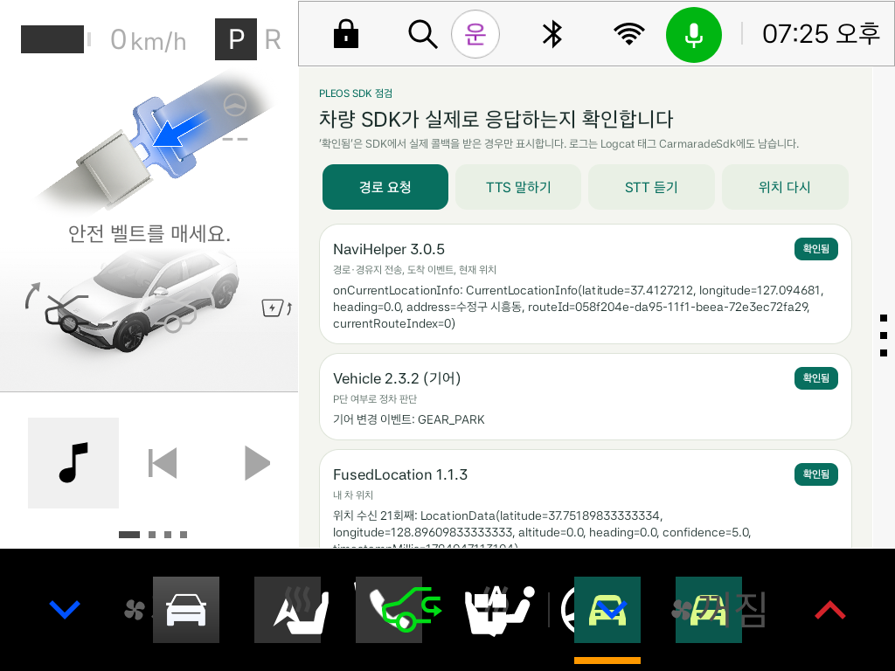

| SDK | 결과 | 실제로 받은 응답 |
|---|---|---|
| NaviHelper 3.0.5 | **동작** | `initialize` 연결 성공. `requestRouteWithWaypoints`(목적지+경유지 1개)를 보내자 Pleos 내비가 앞으로 나와 길안내를 시작했고 `onRouteStarted(RouteStartInfo(...))`가 왔습니다. `getCurrentLocationInfo()` → `onCurrentLocationInfo`로 위도·경도·주소(`수정구 시흥동`)·routeId를 받았습니다. |
| Vehicle 2.3.2 (기어) | **동작** | `getGear().getCurrentGearSelectionState` → `GEAR_PARK`, `registerGearSelection` 리스너도 `GEAR_PARK` 이벤트를 받았습니다. |
| FusedLocation 1.1.3 | **동작** | `isSupported()=true`. `getLastKnownLocation`과 등록 콜백이 약 1초마다 `LocationData`를 줍니다. 에뮬레이터 GPS를 따르며, `adb emu geo fix 128.8961 37.7519`(강릉)로 바꾸자 위치도 바뀌었습니다. |
| TextToSpeech 3.3.1 (ON_DEVICE) | **동작** | 초기화 성공. `speak()`에 `onReady → onStart → onDone`이 왔습니다. 클라이언트 ID·시크릿 없이 ON_DEVICE 모드만 썼습니다. |
| SpeechToText 3.3.1 (ON_DEVICE) | **부분 확인** | 초기화 성공, `request()` 후 `onReady`까지 받았습니다. 에뮬레이터 마이크로 들어온 음성이 없어 인식 결과(`onUpdated`)는 확인하지 못했습니다. |

### 이번 실행에서 알게 된 점
- **'준비 중' SDK도 에뮬레이터에서는 매니페스트 권한만으로 동작합니다.** FusedLocation·STT·TTS가 그렇습니다. 다만 이것은 에뮬레이터 결과일 뿐이고, 실차 배포나 App Market 심사에서 허용된다는 뜻은 아닙니다. 기획서에는 여전히 "Pleos 제공 예정 SDK 연동"으로 적는 편이 안전합니다.
- **위치 출처가 둘입니다.** 에뮬레이터에서 내비 위치(`onCurrentLocationInfo`, 판교 부근)와 FusedLocation 위치(에뮬레이터 GPS, 기본값은 미국 마운틴뷰)가 서로 달랐습니다. FusedLocation이 열리지 않아도 **내비 위치로 내 위치를 얻을 수 있음**이 확인됐습니다.
- `FUSED_LOCATION`은 런타임 권한이라 점검 화면에서 요청합니다. 이번 실행은 `adb install -g`로 권한을 미리 준 상태라 권한 대화상자는 확인하지 않았습니다.
- 경로 요청 뒤 10초 안에 `onRoutingCompleted`는 오지 않았고 `onRouteStarted`만 왔습니다. 경로 적용 확인은 `onRouteStarted`를 기준으로 하는 편이 좋습니다.
- 에뮬레이터의 시스템 키보드(`ai.umos.inputmethod`)가 가끔 스스로 종료됩니다. 우리 앱과는 관계없는 이미지 쪽 문제입니다.
- 기존 메인 화면(카마라드 체험)도 Pleos 화면 안에서 정상 표시됩니다.

### 이 PC에서 빌드·실행하는 방법
- **JDK 17이 필요합니다.** Android Studio에 들어 있는 JDK 25로는 Gradle 8.14/Kotlin 2.0.21 빌드가 시작되지 않습니다. Temurin 17을 쓰세요(이번에는 `~/.jdks/jdk-17.0.21+9`에 받아 `JAVA_HOME`으로 지정했습니다).
- 이미지는 SDK Manager 대신 `crp-sys-img.xml`에 적힌 `crp_car_emulator.zip`(4.09GB, SHA-1 `b4f858d5…`)을 직접 받아 `Sdk/system-images/android-34/pleos_car_emulator/x86_64`에 풀었습니다. 압축을 풀면 약 20GB입니다. AVD는 `avdmanager create avd -n Pleos_Connect_2_1 -k "system-images;android-34;android-automotive;x86_64" -d automotive_1024p_landscape`로 만든 뒤 RAM 4GB, 데이터 6GB, 호스트 GPU, Cold boot로 바꿨습니다.
- **화면 크기는 꼭 2560×1440으로 바꾸세요(2026-11-10 추가).** 위 명령의 `automotive_1024p_landscape`는 1024×768이라, Pleos 하단 바(공조·앱 바로가기)가 겹쳐 보이고 실제와 다른 크기로 시험하게 됩니다. Pleos 이미지의 기기 정의(`devices.xml`, "Pleos Connect v2.1.0")는 2560×1440, mdpi, 12.8인치입니다. `~/.android/avd/Pleos_Connect_2_1.avd/config.ini`에서 `hw.lcd.width=2560`, `hw.lcd.height=1440`, `hw.lcd.density=160`으로 고친 뒤 에뮬레이터를 다시 켜면 됩니다.
- **Pleos는 앱의 Toast 알림을 화면에 띄우지 않습니다.** 사용자에게 보여 줄 안내는 앱 화면 안에 직접 그려야 합니다(메인 앱은 화면 아래 알림으로 바꿈).

## 추가 확인: 주행 상태·권한·도착 이벤트·STT (2026-11-07)

주행 상태는 Pleos 웹 Virtual Console로 바꿨습니다(`adb forward tcp:8088 tcp:8088` → `http://127.0.0.1:8088` → Emulation Controls → Gear Selection, 화면의 ACCEL/BRAKE). 공식 안내: https://document.pleos.ai/docs/pleos-only/app-test-guide/virtual-console-guide
문서의 주행 규제 명령(`cmd hmg_car_service ... driving_regulation`)은 이 이미지에 서비스가 없어 쓸 수 없었습니다.

### 주행 중에는 앱 화면이 가려집니다 (가장 중요)
- 차가 움직이자 Pleos 홈이 앱 화면을 **"주행 중에는 사용할 수 없습니다."**로 덮었습니다. 홈 화면 로그에 `distractionOptimized: false`로 판정됩니다. **현재 메인 앱(카마라드 체험)도 같은 상태라 주행 화면을 실제 주행 중에는 보여 줄 수 없습니다.**
- 액티비티에 Android Automotive 표준 선언 `<meta-data android:name="distractionOptimized" android:value="true" />`를 넣으면 주행 중(11~30km/h)에도 화면이 표시됐습니다. 에뮬레이터는 직접 설치한 앱의 선언을 그대로 인정합니다. 실차·App Market에서도 인정되는지는 Pleos 심사 기준(앱 카테고리, 운전자 주의 분산 가이드)을 확인해야 합니다.
- 이번에는 SDK 점검 화면에만 넣었습니다. 메인 앱에 넣을지는 결정이 필요합니다(넣으면 키보드 화면 등도 주행 중에 열리므로 앱이 스스로 막아야 함).

### CarUxRestrictions
| 상태 | Pleos 설정 | 앱이 받은 값 |
|---|---|---|
| P단(parked) | 제한 없음 `0x0` | 주행 최적화 필요=false, `0x0` |
| D단 정지(idling) | `0x50` | 주행 최적화 필요=true, `0x50`(동영상 금지, 설정 금지) |
| D단 주행(moving) | `0x50` | 상태가 바뀌어도 값이 같아 추가 이벤트 없음 |
- **Pleos 설정은 주행 중에도 키보드를 금지하지 않습니다(`UX_RESTRICTIONS_NO_KEYBOARD` 없음).** 문자열 최대 120자, 목록 최대 21개, 깊이 3입니다. 주행 중 키보드 금지는 앱이 직접 해야 하며, 판단 기준은 `isRequiresDistractionOptimization`(D단이면 정지 중에도 true)이나 기어(P단 여부)를 쓰면 됩니다.
- Vehicle SDK 기어 이벤트도 `GEAR_DRIVE`, `GEAR_PARK`로 바로 왔습니다.

### 권한 대화상자 (`adb install -g` 없이 새로 설치)
- 마이크(`RECORD_AUDIO`) → 위치(`FUSED_LOCATION`) 순서로 대화상자가 떴고, 둘 다 허용하자 모든 점검이 통과했습니다.
- **`FUSED_LOCATION` 대화상자 문구가 "카마라드 체험에서 알 수 없는 작업 실행하도록 허용하시겠습니까?"로 표시됩니다.** Pleos 권한에 설명 문구가 없어서입니다. 사용자에게 혼란을 주므로 권한을 요청하기 전에 앱 화면에서 "내 차 위치를 일행에게 보여 주기 위해 위치 권한이 필요합니다" 같은 안내를 먼저 보여 줘야 합니다.
- 설치 직후 첫 실행에서는 대화상자가 떴다가 곧바로 사라져 앱이 빈 화면으로 남았습니다(홈 화면이 작업 창을 숨김). 다시 실행하자 정상으로 떴습니다. 한 번만 일어났지만 실차에서도 확인이 필요합니다.

### 도착 이벤트: 에뮬레이터에서 확인 불가
- 경로 요청에 `onRouteEnded`(이전 경로 종료) → `onRouteStarted` → `onNavigationStatus: ROUTE_DRIVE` 순서로 이벤트가 왔습니다.
- 내비 현재 위치는 판교(37.4127, 127.0947)에 고정되어 있습니다. 에뮬레이터 GPS(`geo fix`)를 바꿔도, Virtual Console로 차를 30km/h로 달려도 움직이지 않았습니다. Pleos 문서에도 내비 모의주행 방법이 없습니다. 그래서 `onWayPointArrived`·`onDestinationArrived`는 확인하지 못했고, 점검 화면에는 두 이벤트를 받으면 표시하도록 넣어 두었습니다.
- **"도착 시 위치공유 자동 종료"는 에뮬레이터 시연에서 내비 이벤트로 보여 줄 수 없습니다.** 시연용으로는 앱 안의 시뮬레이션이 필요합니다.

### STT: 녹음·인식 루프는 동작, 결과는 미확인
- `request()` 후 Pleos 음성 서비스가 마이크를 열고(16kHz) 인식 루프를 실제로 돌렸습니다(서비스 로그 `recognize(ai.camarade.app.demo) ...`).
- 에뮬레이터 PC 마이크 연결(`adb emu avd hostmicon`)을 켜고 사람이 말했지만, 앱이 받은 입력 크기(RMS)가 무음 수준(0.5)에서 변하지 않아 인식 결과가 없었습니다. 에뮬레이터가 소리가 없는 Windows 입력 장치를 잡은 것으로 보입니다. 시험 뒤 연결은 다시 껐습니다.
- **`stop()`을 부르지 않으면 인식 세션이 계속 다시 시작되며 마이크를 놓지 않습니다**(상태 표시줄 마이크 표시가 계속 켜짐). 점검 화면은 15초 뒤와 화면을 닫을 때 `stop()`을 부르도록 고쳤습니다. 실제 기능에서도 반드시 멈춰야 합니다.

## 에뮬레이터에서 남은 확인

1. STT 인식 결과: Windows 기본 입력 장치를 실제 마이크로 맞추고, 에뮬레이터 Extended controls → Microphone에서 호스트 입력을 켠 뒤 다시 시험(점검 화면 로그의 RMS가 오르는지 먼저 확인).
2. 도착 이벤트: 실차 또는 내비 모의주행 기능이 생기면 확인.
3. ~~메인 앱의 `distractionOptimized` 적용 여부 결정 후 주행 중 화면 확인.~~ 2026-11-08 적용함. D단 56km/h에서 주행 화면이 계속 보이고, 주행 중에는 앱이 직접 주행 화면·위치공유 설정만 열어 줍니다(CarUxRestrictions의 주행 최적화 필요 상태 기준). P로 바꾸면 다른 화면이 다시 열립니다.
4. 음성 읽어주기를 Pleos TTS(ON_DEVICE)로 바꿈. 에뮬레이터 로그에서 화자 seoyoon으로 발화 후 onDone까지 확인. Pleos 초기화가 실패하면 Android TTS로 바꿉니다.

## 지도 API 확인 (2026-11-10)

Pleos Maven 저장소의 모든 패키지(`NaviHelper`, `navi-data`, `Vehicle`, `FusedLocation`, `SpeechToText`, `TextToSpeech`, `LLM`, `placesense` 등)와 NaviHelper 3.0.5·navi-data 3.0.4 소스를 직접 확인했습니다.

- **앱 화면 안에 넣는 지도(MapView·지도 타일·마커/경로 그리기) API는 없습니다.** `placesense`는 내부 위치 서비스용 AIDL이고 지도와 관계없습니다.
- 지도와 관련해 쓸 수 있는 것은 `NaviHelper.requestNavigationScreen(NavigationScreenRequest)` 하나입니다. 권한 `pleos.car.permission.NAVI_CUSTOM_MAP`(normal). Pleos 내비의 화면을 앞으로 띄웁니다.
  - `OverviewRoute(RouteOverviewShowInfo(durationMs))`: 현재 경로 전체 보기
  - `MoveToCurrentLocationOnMap`: 현재 위치 지도
  - `SearchPlace(keyword)`, `POIDetailPopup(poiId)`, `NearbyChargingStations`, `RecentDestinations`, `EditRoute`, `RouteOptionList`, `FavoriteMain`, `Settings`, `Foreground`
- 예전 NaviHelper 2.0.3에는 내비 지도에 번호 핀을 찍는 `Assistant.setNumberPins(NumberMarkerInfo)`와 모의주행 `requestSimulatedDrive`가 있었지만, 3.x에서 빠졌고 `NAVI_CUSTOM_ETC`(시스템 앱 전용) 권한이 필요해 우리 앱은 쓸 수 없습니다.
- 따라서 **일행 차량 위치는 계속 앱 자체 화면에 그려야 합니다.** 실제 지도 배경이 필요하면 외부 지도 SDK(네이버·카카오·TMAP·Google 등)를 따로 붙여야 하며, Pleos 심사·네트워크·위치 정책을 확인해야 합니다.

### 적용한 내용
- `PleosNaviMap.kt`: NaviHelper 연결. 주행 화면 오른쪽 위 **지도 버튼**을 누르면
  1. 이 모임 경로(버전)를 아직 내비에 보내지 않았으면 같은 목적지·경유지(최대 2개)를 `requestRouteWithWaypoints`로 보내고,
  2. `onRouteStarted`가 오면 Pleos 내비의 **경로 전체 보기(10초)**를 엽니다.
  3. 10초 안에 응답이 없거나 `onError`면 **현재 위치 지도**를 엽니다.
  4. Pleos 기기가 아니면 안내 문구만 보여 주고 앱 개념도를 그대로 씁니다.
- 매니페스트에 `NAVI_CUSTOM_MAP` 권한 추가.
- `./gradlew :app:assembleDebug` 빌드 성공(JDK 17.0.21, Android SDK 34, build-tools 34.0.0).

### 에뮬레이터 확인 (2026-11-10, Pleos Connect v2.1.0, 2560×1440)
- 주행 화면 오른쪽 위 지도 버튼을 누르자 `requestRouteWithWaypoints`가 Pleos 내비에 전달됐습니다. **`poiId=""`(좌표만)로도 내비가 경로를 만듭니다.** 내비 로그: `OnRouteWithWaypointsRequest(destination=강릉 안목해변 37.7712,128.9487, waypoints=[횡성휴게소])`.
- 약 8초 뒤 `onRouteStarted`(횡성휴게소까지 103km)가 왔고, 이어서 `requestNavigationScreen`이 보내졌습니다. Pleos 내비가 앞으로 나와 경유지 1개를 포함한 경로 후보(추천 3시간 9분, 210km)를 지도에 표시했습니다.
- 같은 경로에서 버튼을 다시 누르면 경로를 다시 보내지 않고 `OverviewRoute(durationMs=10000)`만 보내며, 내비가 경로 전체 보기를 엽니다(`ShowRouteOverviewRequest`).
- 내비 화면이 열리면 Pleos 홈이 우리 앱 창을 숨깁니다. 앱으로 돌아오려면 하단 바의 앱 아이콘을 누릅니다.
- 부팅 직후에는 Pleos 내비가 스스로 앞으로 나와 앱을 가릴 수 있습니다.

| 주행 화면(지도 버튼) | 경로 보낸 직후 | 다시 눌렀을 때(전체 보기) |
|---|---|---|
| 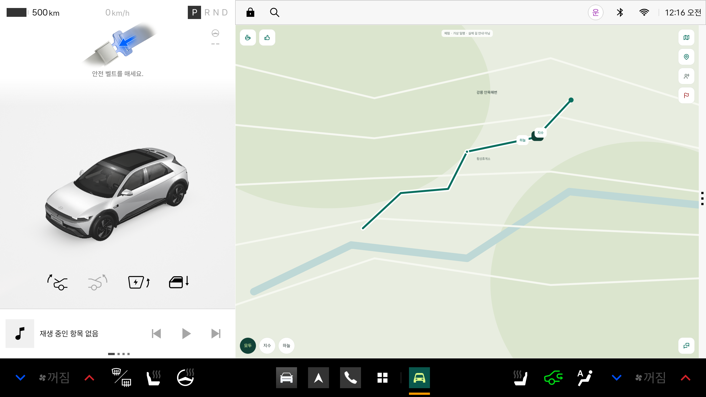 | 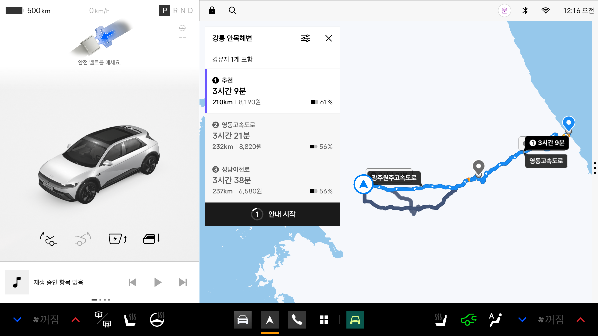 | 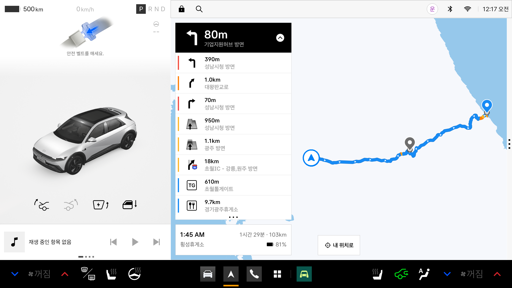 |

## 주행 화면 실제 지도: OpenFreeMap (2026-11-10)

- 주행 화면의 개념도를 **OpenFreeMap 실제 지도**로 바꿨습니다(`LiveMapView.kt`). Android 지도 라이브러리는 MapLibre 12.3.1을 씁니다. 13.x는 Kotlin 2.2 기반이라 이 프로젝트(Kotlin 2.0.21)와 맞지 않습니다.
- OpenFreeMap: 무료, 가입·키 없음, 상업적 사용 가능, **출처 표기 필수**(지도 위쪽에 표시), 가동 보장(SLA) 없음, 길찾기·주소 검색 없음. https://openfreemap.org/
- 지도 라벨은 한국어 이름(`name:ko`)을 먼저 쓰도록 바꿨습니다.
- **경로 선은 그리지 않습니다.** 길 안내는 Pleos 내비가 맡습니다. 목적지·경유지 표시와 일행 차량만 지도에 올립니다.
- 체험 모임에서는 일행이 출발지(서울숲)→경유지→목적지를 잇는 보이지 않는 직선 위에서 시뮬레이션 진행률대로 움직입니다. 온라인 방에서는 서버로 받은 실제 위치를 그립니다(아래).
- 지도 스타일을 불러오지 못하면(인터넷 없음 등) 예전 개념도로 돌아갑니다.
- 네이티브 라이브러리는 `arm64-v8a`, `x86_64`만 넣습니다. 디버그 APK 약 56MB.

### 에뮬레이터 확인
- Pleos 홈의 2칸 분할 화면(우리 앱 + Pleos 내비)에서 지도와 차량 표시가 정상으로 나왔습니다. 분할 상태에서는 Pleos 내비 쪽 지도가 빈 화면으로 보였습니다(내비 앱 쪽 현상).
- 프로필 메뉴 → 위치 보기: 지도가 그 차로 확대·이동하고 점선 원과 남은 거리를 보여 줍니다. 차를 계속 따라가지는 않습니다.
- 에뮬레이터 앱은 Android 사용자 10에서 실행됩니다. 데이터 초기화는 `adb shell pm clear --user 10 ai.camarade.app.demo`.

| 분할 화면에서 주행 지도 | 위치 보기(지수) |
|---|---|
| 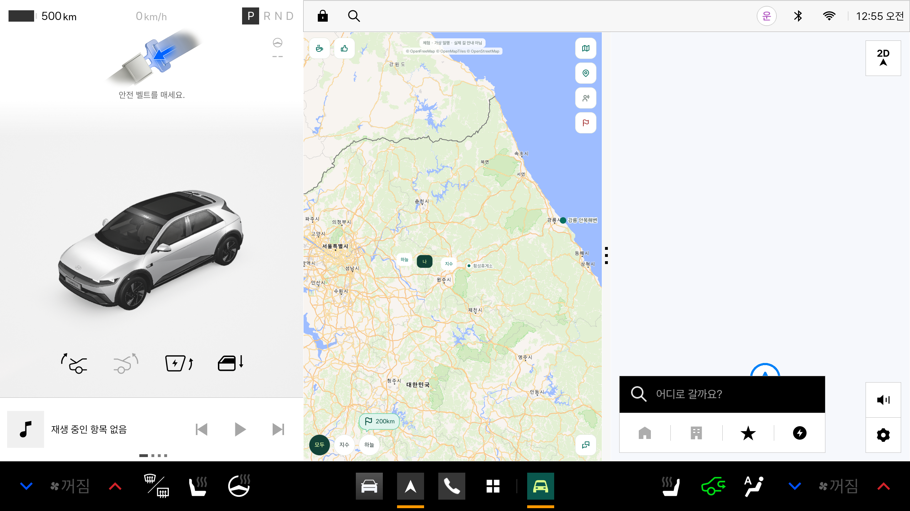 | 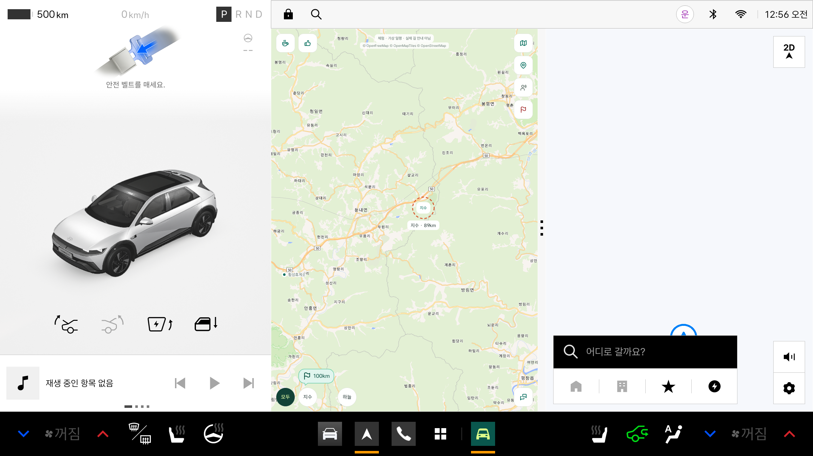 |

## 온라인 방과 위치 공유 (2026-11-11)

서버(`server/`, 사용법은 `server/README.md`)와 앱을 연결했습니다.

- **방 만들기:** 새 동행을 만들 때 "온라인 방"(기본 켜짐)과 "공개 방"을 고릅니다. 서버가 6자리 초대 코드를 만듭니다.
- **방 들어가기:** 홈의 "함께 가는 방" 카드에서 고릅니다. 처음 한 번 닉네임·차량을 정합니다.
  - 초대 코드로 입장: 공개·비공개 모두 됩니다.
  - 같은 목적지 방 찾기: 장소를 고르면 그 목적지(반경 1km)로 가는 공개 방이 나옵니다.
- **방장:** 목적지·경유지를 바꾸면 서버를 거쳐 멤버에게 바로 반영됩니다. 멤버는 바뀐 경로를 다시 수락합니다. 각자 자기 차에서 수락하고 출발합니다.
- **위치 공유:** 출발할 때 정확한/대략적인 위치 공유를 묻고, 그다음 차량 위치 권한을 요청합니다. 권한 요청 전에 이유를 먼저 보여 줍니다. 내 위치는 Pleos FusedLocation에서 받아 2초마다 보냅니다.
  - 일행 위치는 지도에 실제 좌표로 표시되고, 남은 거리 알림도 실제 위치로 계산합니다.
- **메시지:** 쉬어가요·따봉·음성 메시지가 같은 방 멤버에게 전달됩니다.
- **위치가 지워지는 때:** 공유를 끄거나, 동행을 마치거나, 앱이 닫히거나, 방을 나가면 서버에서 바로 지웁니다.

### 확인한 것
- 서버 동작 테스트 12개, 앱 핵심 로직 테스트 24개(방 관련 3개 추가) 통과.
- 에뮬레이터 + 로컬 서버 + 가상 멤버 스크립트(`server/tools/fake-member.js`)로 아래 흐름을 확인했습니다.
  1. 닉네임 등록 → 온라인 방 만들기(코드 5XWG7F)
  2. 가상 멤버 "지수"가 코드로 입장 → 새로고침 후 멤버 목록에 표시
  3. 출발 → 정확한 위치 공유 → 위치 권한 허용
  4. 지도에 내 차(에뮬레이터 GPS)와 지수(서버로 받은 위치)가 함께 표시되고, 지수 쪽도 내 위치를 계속 받음
  5. 따봉이 지수에게 전달됨
- Pleos 키보드는 입력할 때 전체 화면 편집 모드로 바뀝니다. 닉네임 대화상자처럼 칸이 둘이면 키보드의 "다음"으로 칸을 옮겨야 합니다.

### 아직 안 한 것
- 실제 서버 배포(HTTPS), 계정 복구, 신고·차단.
- 멤버의 경로 수락 상태 공유. 지금은 각자 자기 기기에서만 수락합니다.
- 주행 중이 아닐 때(계획 화면)는 멤버 변경이 바로 오지 않아 "새로고침"을 눌러야 합니다.

| 코드로 들어온 멤버 | 두 차량 위치 공유 |
|---|---|
| 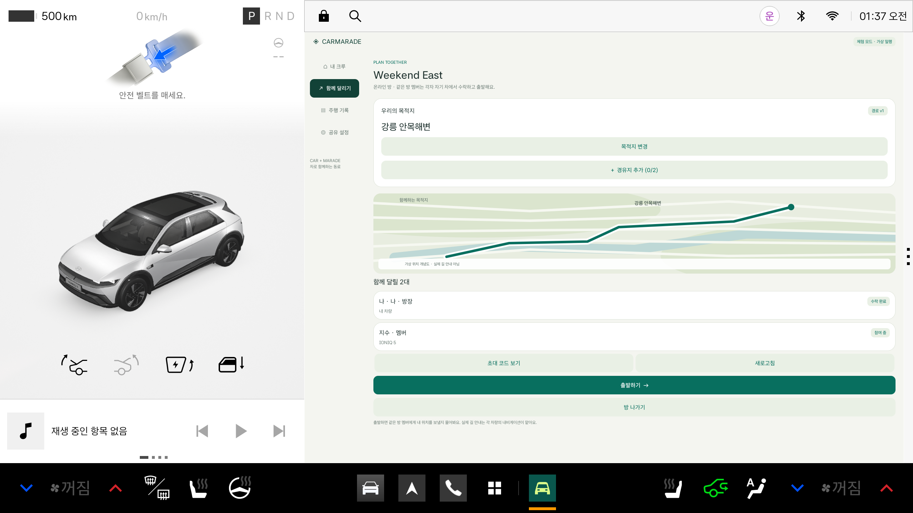 | 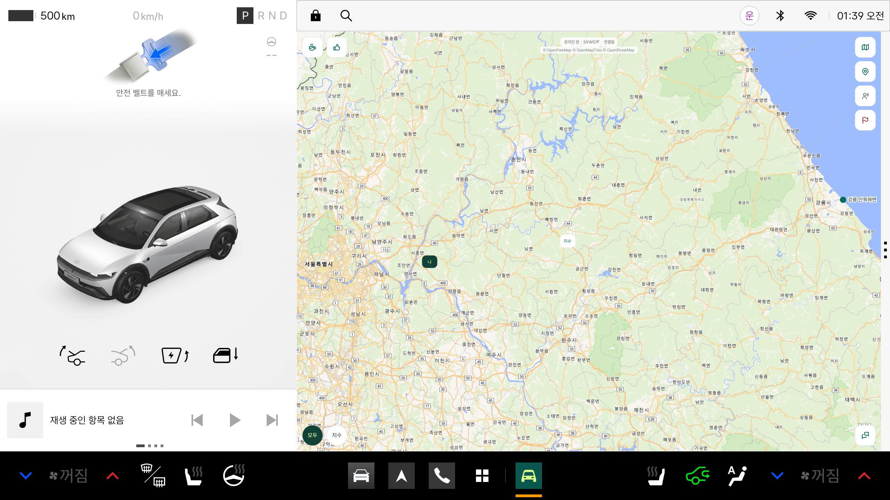 |

## 커뮤니티 탭: 모집 글과 초대 코드 입장 (2026-11-13)

사람을 모으는 곳을 따로 만들었습니다. 왼쪽 메뉴의 **커뮤니티**에서 아래를 할 수 있습니다.
- **초대 코드 입장:** 맨 위 입력칸에 코드를 넣고 "입장"을 누릅니다. 공개·비공개 방 모두 들어갈 수 있습니다.
- **모집 중인 방 목록:** 출발 시간이 가까운 순으로 보입니다. 카드마다 방 이름, 목적지·경유지, 출발 시간, 방장, 인원(n/5대), 모집 글이 있고 "이 방에 참여하기" 버튼이 있습니다.
  - 검색: 방 이름·목적지·모집 글로 찾습니다.
  - 목적지로 찾기: 장소를 고르면 반경 1km 안으로 가는 방이 나옵니다.
- **같이 갈 사람 모집하기:** 온라인·공개 방을 만들면서 모집 글(200자)과 출발 시간(날짜 → 시간 선택)을 넣으면 목록에 올라갑니다.
- 홈의 "함께 가는 방" 카드에도 "모집 중인 방 둘러보기"를 넣었습니다.
- 주행 중이어도 정차해 있으면 커뮤니티를 볼 수 있습니다. 다른 방에 참여하는 것은 이번 동행을 마친 뒤에만 됩니다(두 방에 동시에 위치를 보내지 않도록).
- 멤버 목록에 방장을 "방장"으로 표시합니다.

### 확인한 것
- 서버 테스트 13개(커뮤니티 목록 1개 추가), 앱 핵심 테스트 24개 통과.
- 에뮬레이터에서 확인한 흐름
  1. 다른 사용자 셋이 올린 모집 글 3개가 출발 시간 순으로 나옴
  2. 목록에서 "이 방에 참여하기" → 방이 열림
  3. 초대 코드 `HJ7Q7U` 입력 → "양양 서핑 동행 구해요" 방에 입장
  4. 새로고침하면 멤버 목록에 "지수 · 방장"으로 표시
- 에뮬레이터에서 입력칸을 쓴 뒤 키보드를 닫으려고 뒤로 가기를 누르면 앱 화면도 홈으로 돌아갑니다. 키보드의 확인(Enter)으로 닫아야 합니다.

| 커뮤니티 | 코드로 입장한 방(홈) |
|---|---|
| 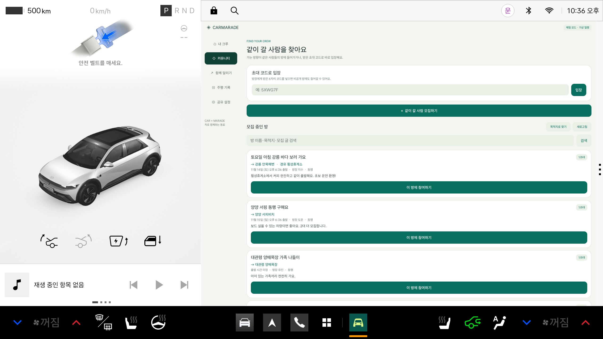 | 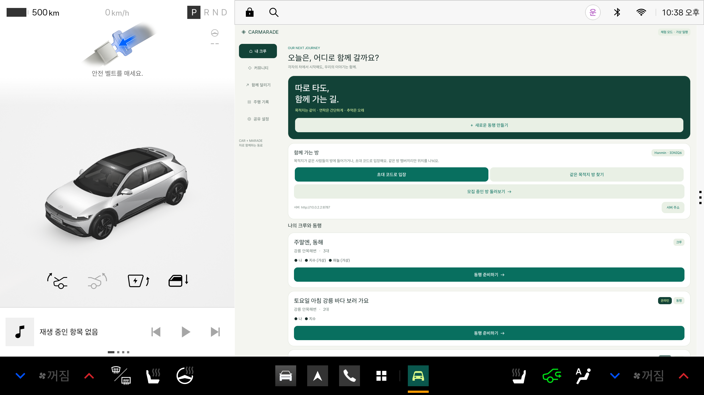 |

## 시연 준비: 멤버 상태 공유, 도착 시 자동 종료, 배포 준비 (2026-11-13)

### 멤버 상태 실시간 공유
- 서버가 멤버마다 **최신 경로 수락 여부**와 **진행 단계**(출발 전·출발함·도착)를 가집니다(`POST /v1/rooms/:id/status`).
  - 방장이 경로를 바꾸면 모두의 수락이 풀립니다.
  - 도착을 알리면 서버의 위치도 지웁니다.
- 앱 동작
  - 경로를 수락하면 "수락", 출발하면 "출발함", 동행을 마치면 "도착"을 서버에 알립니다.
  - **출발 전 화면도 방에 실시간으로 연결**합니다. 새 멤버, 수락, 출발, 경로 변경이 새로고침 없이 바로 보입니다.
  - 멤버 표시: "확인 대기 → 수락 완료 → 출발함 → 도착".
  - 주행 중 일행이 도착하면 말풍선과 음성으로 "○○님이 도착했어요"를 알립니다.

### 도착하면 위치 공유 자동 종료
- 아래 둘 중 먼저 오는 쪽을 도착으로 봅니다.
  - Pleos 내비의 도착 이벤트(`onDestinationArrived`)
  - 내 위치가 목적지 300m 안에 들어옴
- 도착하면 다음을 차례로 합니다.
  1. 내 위치 공유를 끄고 서버에 "off"와 "도착"을 보냅니다(서버에서 위치 삭제).
  2. 위치 받기를 멈춥니다.
  3. 음성으로 "목적지에 도착했어요. 위치 공유를 껐어요"라고 알립니다.
  4. "동행 마치기 / 일행 기다리기"를 묻습니다.

### 배포 준비
- `server/Dockerfile`, `server/deploy/docker-compose.yml` + `Caddyfile`(HTTPS 인증서 자동). 방법은 `server/README.md`를 참고하세요.
- 앱 기본 서버 주소를 빌드할 때 정할 수 있게 했습니다(`-Pcarmarade.serverUrl=https://...`).
- **실제 배포는 아직 하지 않았습니다.** 호스팅 계정과 도메인이 필요합니다. 이 PC에는 Docker가 없어 이미지도 직접 빌드해 보지 못했습니다.

### 확인한 것
- 서버 테스트 14개(멤버 상태 1개 추가), 앱 핵심 테스트 24개 통과.
- 서버를 다시 켤 때 기존 DB 파일에 새 칸(수락·단계·모집 글·출발 시간)이 자동으로 추가되는 것을 확인했습니다.
- 에뮬레이터(양양 방)
  1. 출발 전 화면을 열어 둔 채 가상 멤버 "유진"이 코드로 입장 → 새로고침 없이 3대로 늘어남
  2. 유진의 수락 → "수락 완료", 출발 → "출발함"이 바로 표시
  3. 내가 출발한 뒤 에뮬레이터 GPS를 양양 서피비치 옆으로 옮김 → "목적지에 도착했어요" 창이 뜨고 위쪽에 "도착 · 위치 공유를 껐어요" 표시
  4. 다른 멤버로 확인: 서버에서 내 상태는 `arrived`, 남은 위치 0개
  5. "동행 마치기" → 기록 화면, "모든 위치공유가 종료되었어요"
- Pleos 내비 도착 이벤트는 에뮬레이터에서 내비 위치가 움직이지 않아 이번에도 직접 확인하지 못했습니다. 거리 기준 도착으로 확인했습니다.

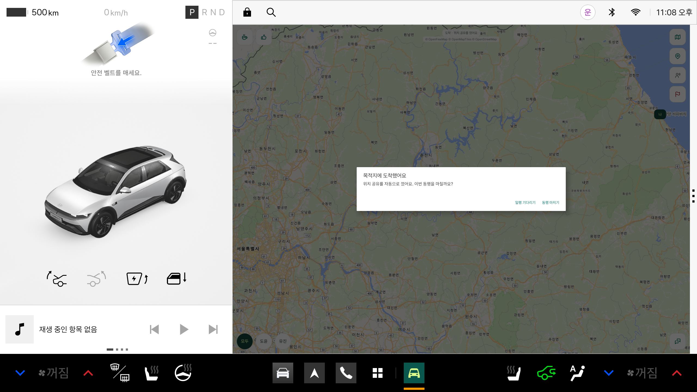

## 초대 코드 입력 화면 개선 (2026-11-14)

초대 코드 입력이 Pleos 전체 화면 키보드에 의존해서 불편했습니다. 글자 칸 하나만 보이고, 키보드가 한글로 시작해 영문 코드를 치려면 지구본 키를 눌러야 했고, "다음/완료"를 누르는 순서에 따라 대화상자가 닫히며 입력이 사라지기도 했습니다.

### 바뀐 것
- **6칸 + 화면 자판** (`CodeEntry.kt`): 코드에 쓰는 글자(영문 대문자 23자 + 숫자 8자, 헷갈리는 0/O, 1/I/L 제외)만 큰 버튼으로 보여 주고, 눌러서 입력합니다. 시스템 키보드는 나오지 않습니다.
  - 틀린 코드면 입력한 칸을 그대로 두고 대화상자 안에 이유를 보여 줍니다. 한 글자만 지우고 고치면 됩니다.
  - 6자리가 차야 "입장"이 진해집니다.
- **커뮤니티 탭과 홈**: 입력칸 대신 "코드 입력하기"/"초대 코드로 입장" 버튼이 같은 입력 화면을 엽니다.
- **방 화면의 큰 코드 카드**: 온라인 방에서는 맨 위에 코드를 큰 칸으로 보여 줍니다. "코드 복사"와 "초대 문구 복사"("카마라드 방 초대 · 방 이름 · 목적지 … · 초대 코드 …")가 있고, 말로 알려 줄 때는 "C4T 2JY"처럼 3글자씩 끊어 읽도록 안내합니다. 체험 모임(온라인 아님)에는 예전처럼 "초대 코드 보기" 버튼을 둡니다.
- 코드 규칙(글자 목록, 정리, 자판 배열, 초대 문구)은 앱 화면과 분리해 `core/InviteCode.kt`에 두고 `tests/InviteCodeTest.kt`로 시험합니다(6개).

### 확인한 것 (에뮬레이터 2560×1440, 로컬 서버)
1. 홈에서 "초대 코드로 입장" → 6칸 + 자판이 열림
2. 틀린 코드 `C4T2JZ` 입력 후 입장 → "초대 코드를 확인해 주세요." 표시, 입력한 코드는 유지
3. 지우기로 `Z`를 지우고 `Y` 입력 → 입장 성공, 방 화면 맨 위에 큰 코드 카드 표시
- 핵심 로직 테스트 30개(Trip 17, DriveSim 7, InviteCode 6) 통과.
- 코드 복사 버튼이 실제 클립보드에 들어가는지, 다른 차량에서 붙여 넣을 수 있는지는 확인하지 못했습니다. Pleos에서 폰으로 보내는 경로(공유 기능)도 아직 확인 전입니다.

| 이전(Pleos 키보드, 글자 칸 하나) | 새 입력 화면 | 틀린 코드 |
|---|---|---|
| 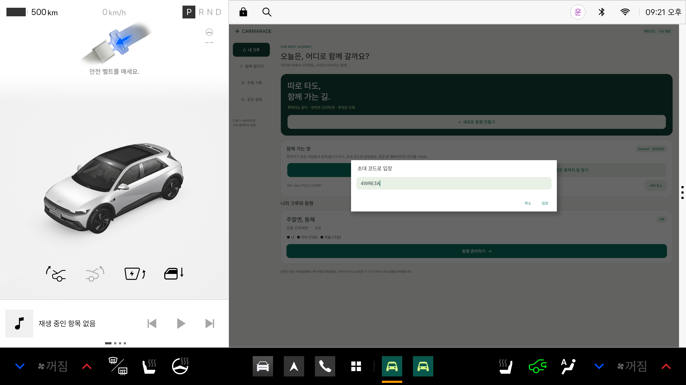 | 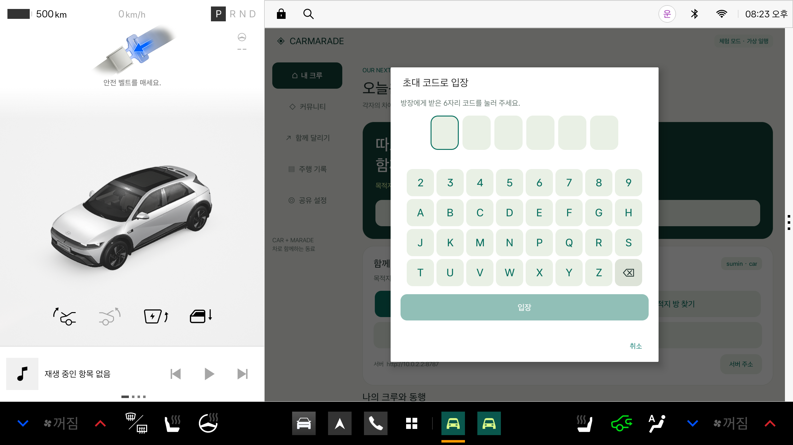 | 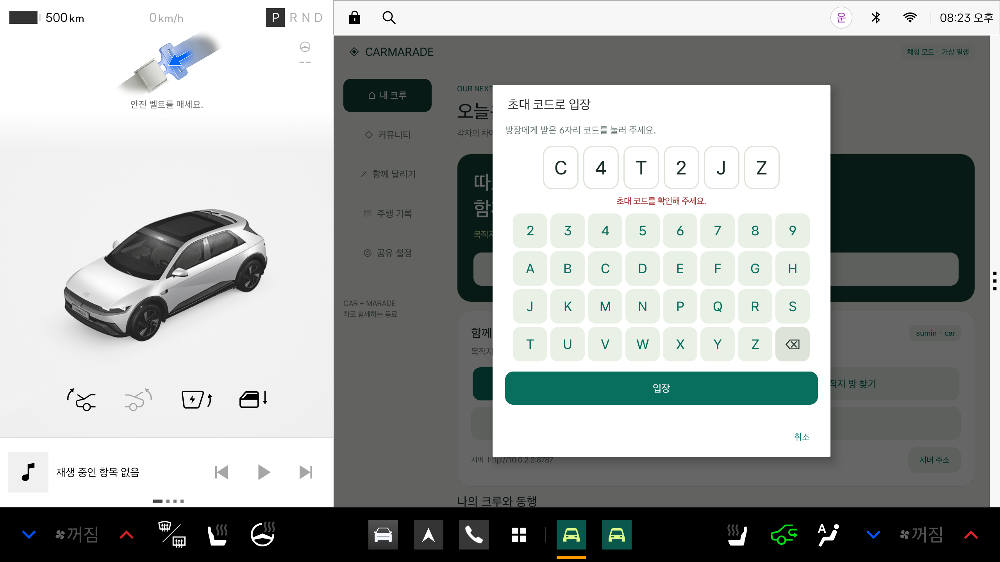 |

| 방 화면의 코드 카드 |
|---|
| 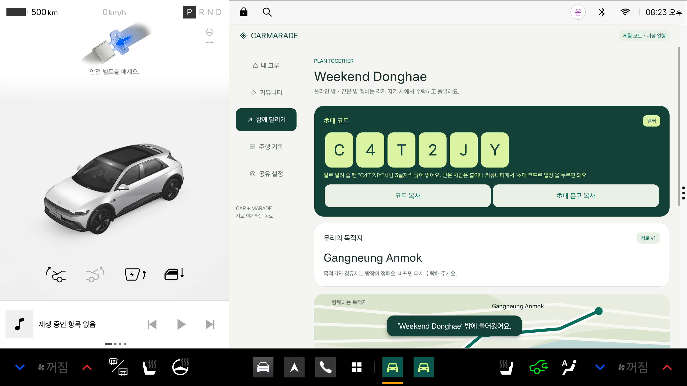 |
